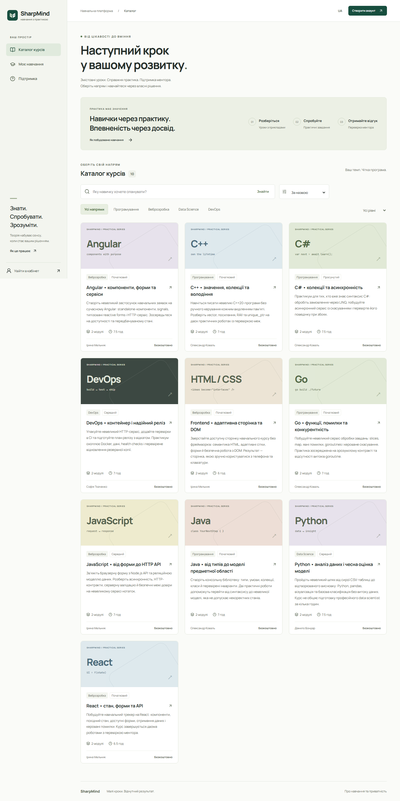
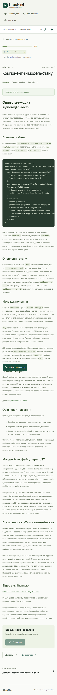

# SharpMind

ІТ-навчання українською з практикою та підтримкою ментора. Студент проходить матеріали, складає тести, отримує відгуки на власні рішення та підтверджує завершення програми сертифікатом.

Версія зберігає сценарій оригінального SharpMind: каталог → заявка → схвалення ментора → навчання → оцінювання. Результати спроб тепер мають історію, правила прогресу й сертифіката узгоджені, а видалення навчальних записів замінено архівацією та блокуванням. Матеріали редагуються в майстерні, а доступ до них перевіряє сервер.



## Можливості

- Публічний каталог із пошуком, фільтрами напрямів і рівнів, сортуванням та пагінацією.
- Реєстрація студента, вхід, вихід, зміна пароля та серверна перевірка ролей.
- Заявка на курс, рішення ментора з поясненням і можливість повторного звернення після відмови.
- Теоретичні уроки з прикладами, самоперевіркою, офіційною англомовною документацією та англомовними відео.
- Тести по 10 питань, пояснення відповідей, історія спроб, пауза між повторами та збереження найкращого результату.
- Практичні роботи з чернеткою в поточній вкладці, перевіркою ментора, оцінюванням за критеріями й повторним поданням після доопрацювання.
- Прогрес, псевдонімний рейтинг курсу, унікальний сертифікат із перевіркою за посиланням та друком / збереженням у PDF через браузер.
- Майстерня: створення чернеток, редактор матеріалів і питань, порядок модулів, публікація, архів, заявки, черга перевірки та фактична статистика.
- Фото PNG/JPEG/WebP до 5 МіБ і відео MP4/WebM до 100 МіБ. Файли доступні лише відповідному ментору, адміністратору та зарахованим студентам. Для відео потрібна текстова версія або докладний конспект.
- Адміністрування ролей, блокування акаунтів, перепризначення ментора й відповіді підтримки.

Курси в цій версії безоплатні. Збір даних картки та фіктивне підтвердження платежу відсутні. Сертифікат підтверджує завершення програми SharpMind, а не державну акредитацію.

## Два варіанти даних

**Демо:** 10 повністю наповнених коротких курсів, 20 модулів, 20 практичних робіт і 300 питань. Кожен курс містить два модульні тести та фінальний іспит, по 10 питань у кожному. Орієнтовний час курсу — 6–8 годин із практикою.

**Чиста система:** лише схема БД; жодних користувачів, курсів, заявок або результатів. Першого адміністратора створюєте окремою командою, а власні курси — через майстерню.

Ініціалізація не видаляє наявних даних. Повторний імпорт додає тільки відсутні курси й акаунти, не перезаписує матеріали, паролі або результати. `--empty` не очищає вже заповнену базу. Для справді чистого старту потрібна нова БД / новий Compose-проєкт.

## Запуск із нуля: весь застосунок у Docker

Потрібні Git, запущений Docker Desktop у режимі Linux containers із Docker Compose та Node.js 24 LTS для допоміжної команди конфігурації. .NET SDK для цього способу не потрібен: збірка відбувається в контейнері.

```powershell
git clone https://github.com/Andrew543210/dotnet-react-sharpmind-learningplatform.git
cd dotnet-react-sharpmind-learningplatform
node scripts/configure.mjs
docker compose --profile app build app
```

`configure.mjs` створить ігнорований Git файл `.env` із випадковими локальними паролями та шляхами сховищ. Наявний `.env` не змінюється. Альтернатива без Node.js: скопіюйте `.env.example` у `.env` та замініть значення `POSTGRES_PASSWORD` і `Demo__Password` власними довгими випадковими значеннями. Не використовуйте рядки-заповнювачі як робочі паролі.

Оберіть **одну** ініціалізацію.

### Варіант A — із демоданими

```powershell
docker compose --profile app run --rm app --migrate --seed-demo --seed-content
docker compose --profile app up -d --wait
```

Відкрийте [http://localhost:8080](http://localhost:8080). Перевірка готовності: [http://localhost:8080/api/health/ready](http://localhost:8080/api/health/ready).

| Роль | Пошта | Напрям |
| --- | --- | --- |
| Адміністратор | `admin@demo.sharpmind.test` | Усі адміністративні дії |
| Ментор | `mentor@demo.sharpmind.test` | C#, Java, C++, Go |
| Ментор | `mentor2@demo.sharpmind.test` | React, Angular, Frontend, JavaScript |
| Ментор | `mentor3@demo.sharpmind.test` | Python / Data Science |
| Ментор | `mentor4@demo.sharpmind.test` | DevOps |
| Студент | `student@demo.sharpmind.test` | Особисте навчання |

Спільний **локальний** пароль демоакаунтів — значення `Demo__Password` у вашому `.env`. Воно генерується під час налаштування й не публікується в Git. Пошти `.test` навчальні: надсилання листів не налаштоване. Демоініціалізація заборонена в Production.

У демо немає вигаданих успішних результатів: студент подає заявку, ментор відкриває доступ і перевіряє роботи. Щоб перевірити навчання, відкрийте дві окремі браузерні сесії — студента та ментора потрібного напряму.

### Варіант B — чиста система

На новій базі після спільних кроків збірки:

```powershell
docker compose --profile app run --rm app --migrate
docker compose --profile app up -d --wait
```

Каталог порожній, акаунтів немає. Для першого адміністратора додайте у локальний `.env`:

```dotenv
Bootstrap__Email=owner@example.com
Bootstrap__FullName=Адміністратор платформи
Bootstrap__Password=replace-with-a-unique-passphrase-of-at-least-15-characters
```

Замініть приклад пароля власним, після чого виконайте:

```powershell
docker compose --profile app run --rm app --bootstrap-admin
```

Команда відмовиться створювати другого початкового адміністратора або переписувати існуючі акаунти. Видаліть `Bootstrap__Password` із `.env` після успіху. Увійдіть створеним адміністратором. Інші користувачі реєструються студентами; адміністратор призначає менторів у розділі «Користувачі». Адміністратор також може створювати курси й призначити відповідального ментора.

Якщо хочете імпортувати тільки навчальні програми без демоакаунтів, спочатку створіть реального ментора, вкажіть його пошту як `Content__MentorEmail` у `.env`, потім виконайте:

```powershell
docker compose --profile app run --rm app --seed-content
```

### Стан, зупинка та повторний запуск

```powershell
docker compose --profile app ps
docker compose --profile app logs --tail 100 app
docker compose --profile app stop
docker compose --profile app up -d --wait
```

PostgreSQL, медіа та ключі сесій зберігаються в окремих іменованих volumes (`postgres-data`, `media-data`, `keys-data`). Звичайна зупинка не видаляє їх. **`docker compose down -v` видаляє volumes із даними**, тому не використовуйте цю команду для звичайної зупинки.

Порти прив’язані до `127.0.0.1`: PostgreSQL — `54329`, застосунок — `8080`. Якщо порт зайнятий, змініть `POSTGRES_PORT` або `APP_PORT` у `.env`. Після зміни пароля в уже ініціалізованій БД він не зміниться автоматично: потрібна відповідна процедура PostgreSQL. Не видаляйте базу заради виправлення конфігурації.

Для паралельної окремої порожньої установки використайте іншу копію `.env`, інші порти й іншу назву проєкту: `docker compose -p sharpmind-empty --env-file .env.empty --profile app ...`. Це створить окремий volume. Не називайте існуючу демобазу «чистою» без перевірки її вмісту.

## Запуск для розробки: PostgreSQL у Docker, React і .NET локально

Додатково потрібні .NET 10 SDK **10.0.400 або новіший підтримуваний SDK гілки 10.0**, Node.js 24 LTS і npm. Перевірте `dotnet --version`, `node --version`, `docker compose version`. Версію SDK задає `global.json`; [офіційні завантаження .NET](https://dotnet.microsoft.com/en-us/download/dotnet/10.0).

Із кореня чистого клону виконайте одну команду:

```powershell
# Демо: база, міграції, 10 курсів і навчальні акаунти
node scripts/setup.mjs --demo

# АБО чиста нова база: без акаунтів і курсів
node scripts/setup.mjs --empty
```

Скрипт створює `.env`, запускає PostgreSQL, відновлює інструмент EF і зафіксовані залежності, виконує міграції та обрану ініціалізацію. Обидві команди зберігають наявні дані.

У двох терміналах:

```powershell
# Термінал 1 — backend
node scripts/run.mjs api
```

```powershell
# Термінал 2 — frontend
node scripts/run.mjs web
```

Frontend: [http://127.0.0.1:5173](http://127.0.0.1:5173). API: [http://localhost:5080/api/health/ready](http://localhost:5080/api/health/ready). Vite проксіює `/api` на backend; відкривайте UI через frontend-адресу. У цьому способі медіа й ключі зберігаються за шляхами `Media__RootPath` та `DataProtection__KeyPath` у `.env`, типово `data/media` і `data/keys`. Для першого адміністратора в порожньому режимі задайте `Bootstrap__*` у `.env` і виконайте `node scripts/run.mjs db-task --bootstrap-admin`. При переході між локальним backend і контейнером перенесіть відповідні медіафайли та ключі разом із БД; це різні сховища файлів.

## Правила проходження

1. Усі уроки позначено прочитаними.
2. Кожен модульний тест складено щонайменше на **70%**.
3. Кожну практику ментор оцінив щонайменше на **60/100**: коректність — 40, обґрунтування — 25, перевірки — 25, зрозумілість — 10.
4. Після цього відкривається фінальний іспит; потрібно **80%**.
5. Повторна видача повертає той самий сертифікат. Ім’я, назва курсу й оцінка фіксуються на момент видачі.

Між спробами тесту — 60 секунд. За 24 години дозволено до 10 спроб модульного тесту та до 5 фінального. Практику не можна перезаписати, поки ментор її перевіряє; після оцінки нижче 60 дозволена нова версія з окремою історією. Програма курсу й медіа захищаються від змін після першого схваленого зарахування. Для іншої програми створіть новий курс.



## Технології та архітектура

- React 19, TypeScript зі strict-перевіркою, Vite, React Router, локально розміщені шрифти Manrope / JetBrains Mono.
- ASP.NET Core 10 LTS, Identity, cookie-сесії, antiforgery, rate limiting, явні HTTP-контракти.
- EF Core 10 з відстежуваними міграціями та PostgreSQL 18.
- xUnit + WebApplicationFactory на справжній ізольованій PostgreSQL, Testing Library / Vitest, Playwright і axe.

Модульний моноліт: `Domain` містить сутності, структуру програми й правила проходження; `Features` — HTTP-контракти та сценарії; `Infrastructure` — EF, міграції, Identity й явну ініціалізацію. Немає мікросервісів, універсального repository або CQRS.

PostgreSQL обрано за транзакції, унікальні обмеження та блокування рядків для одночасних запитів. Користувачі, зарахування, спроби, роботи, сертифікати й медіадані зберігаються реляційно. Програма курсу — перевірений цілісний документ `jsonb`, захищений від змін після початку навчання; прогрес посилається на стабільні ключі модулів. Це дозволяє редактору зберігати чернетку без складного дерева взаємозалежних HTTP-змін.

Frontend організований за модулями `auth`, `catalog`, `learning`, `staff`, `support`; `shared/api.ts` ізолює мережевий контракт, `hooks.ts` — завантаження, повторне надсилання та захист незбережених форм. Сторінки завантажуються окремими chunks.

```text
src/SharpMind.Api/
  Domain/          сутності, програма й правила
  Features/        API та прикладні сценарії
  Infrastructure/ EF Core, міграції, Identity, ініціалізація
  Content/         10 навчальних програм
web/src/
  app/             маршрути та оболонка
  features/        функціональні модулі
  shared/          API, типи й спільні елементи
tests/             бізнес-правила та API-перевірки
scripts/           запуск, збірка, тести й backup
```

## Конфігурація й міграції

Приклад без робочих секретів — [.env.example](.env.example). `.env`, `data`, бази, media, ключі, `node_modules`, `bin/obj` і результати тестів ігноруються Git.

Міграції застосовуються окремою командою, не кожним запуском сервера:

```powershell
node scripts/run.mjs db-task --migrate
```

Для нової зміни моделі розробник створює наступну міграцію, переглядає її та комітить разом зі snapshot. Існуючі міграції не потрібно створювати заново. Для роботи EF CLI передайте `ConnectionStrings__Database` через змінні середовища; не додавайте секрет до аргументів команди або Git.

## Перевірки

Після локального `setup` із запущеною PostgreSQL:

```powershell
dotnet restore --locked-mode
dotnet build --no-restore -c Release
node scripts/test-backend.mjs -c Release
npm ci --prefix web
npm run typecheck --prefix web
npm run lint --prefix web -- --deny-warnings
npm run format:check --prefix web
npm test --prefix web
npm run build --prefix web
node scripts/audit-dependencies.mjs
```

API-тести створюють випадкові бази `sharpmind_test_*` і видаляють тільки їх. Для іншої тестової PostgreSQL задайте `SHARPMIND_TEST_CONNECTION` з правом CREATE DATABASE. Робоча база тестами не очищується.

Наскрізні перевірки:

```powershell
npm exec --prefix web playwright install chromium
node scripts/e2e.mjs
```

E2E створює окрему базу `sharpmind_e2e_*`, власні демодані та сервери на портах 5081/5174 і видаляє лише цю базу після завершення. Потрібна та сама локальна PostgreSQL або `PGHOST`, `PGPORT`, `PGUSER`, `PGPASSWORD`. Перевіряються заявка, рішення ментора, навчання, оцінки, сертифікат, фото/відео, доступи, фільтри й адаптивність. Playwright-відеофікстура — короткий власний технічний ролик, не навчальний контент демокурсів.

Для аудиту NuGet:

```powershell
dotnet list package --vulnerable --include-transitive --format json > dependency-audit.json
node scripts/check-dotnet-audit.mjs dependency-audit.json
```

[CI на GitHub Actions](https://github.com/Andrew543210/dotnet-react-sharpmind-learningplatform/actions/workflows/ci.yml) відновлює зафіксовані залежності, збирає backend/frontend, перевіряє TypeScript і форматування, запускає тести, перевіряє міграції, залежності та production-пакет. Межі перевірок і відома невиправлена проблема інструментів розробки описані в [security.md](docs/security.md).

## Збірка й розгортання

```powershell
node scripts/publish.mjs
```

Результат — `data/publish` із API та `wwwroot` production-збірки React. Dockerfile виконує таку саму багатостадійну збірку й запускає процес від непривілейованого користувача.

Compose у цьому репозиторії призначений для локального запуску та явно використовує Development із loopback-портами. Для production:

- Використайте Production, реальну PostgreSQL із мінімальними правами та захищеним з’єднанням, належне сховище секретів і власний домен.
- Налаштуйте HTTPS у Kestrel або через TLS-проксі. Для проксі задайте точну довірену IP-адресу в `ReverseProxy__Address`; не довіряйте довільним forwarded headers.
- Персистуйте `DataProtection__KeyPath` і `Media__RootPath` на захищених сховищах. Для одного екземпляра підходить постійний диск; багаторепліковий запуск потребує спільного сховища й узгоджених лімітів.
- Застосуйте міграції окремим кроком після резервної копії, створіть першого адміністратора, не додавайте демоакаунти.
- Перевірте readiness, вхід, зарахування, читання медіа й резервне відновлення. Оновлюйте ОС та базові образи.

Наявність збірки та успішного CI означає перевірений код і пакет. Репозиторій не створює публічний сервер автоматично.

## Резервні копії й перевірка відновлення

Для локального Compose:

```powershell
node scripts/backup.mjs
node scripts/restore-check.mjs data/backups/<timestamp>/database.dump
```

Backup містить PostgreSQL custom archive, media та ключі сесій, якщо відповідні папки існують. Перевірка відновлює архів в окрему базу `sharpmind_restore_*`, перевіряє читання таблиць і видаляє тільки тестову базу. Вона не перезаписує робочі дані. Для повної production-перевірки також запустіть застосунок на відновленій БД й копії media та пройдіть ключові сценарії.

Копії містять приватні дані: обмежте доступ, зберігайте зашифровану копію поза цією машиною та визначте строки зберігання. Під час знімка БД і media призупиніть редакторські зміни, щоб копії були узгоджені. Перед відновленням на робочому сервері зупиніть запис, перевірте сумісність версії коду та не замінюйте єдину робочу базу неперевіреним архівом.

## Межі поточної версії

- Немає платежів, MFA, підтвердження пошти, автоматичного відновлення пароля чи надсилання листів. Зміна відомого пароля доступна в кабінеті.
- Немає автоматичного виконання коду студента, акредитованих дипломів, відеотранскодування або CDN. Браузер має підтримувати кодек завантаженого MP4/WebM.
- Формат медіа перевіряється за сигнатурою й розміром; це не повний антивірусний аналіз. Приймаються файли тільки від staff.
- Адміністрування використовує блокування акаунта й архівацію курсу, щоб зберегти навчальні записи. Автоматичного повного стирання персональних даних немає.
- Ліміти запитів діють в одному процесі. Масштабування потребує окремого налаштування спільних ключів, сховища й throttling.
- Відео та документація відкриваються на зовнішніх сайтах; їхня доступність може змінитися. Список джерел і права використання — [content-sources.md](docs/content-sources.md).

Шрифтові ліцензії збережено в [docs/licenses](docs/licenses), повідомлення бібліотек frontend — у [third-party-notices.txt](web/public/third-party-notices.txt). Логотип — власний SVG-знак книги SharpMind, без сторонніх зображень.
